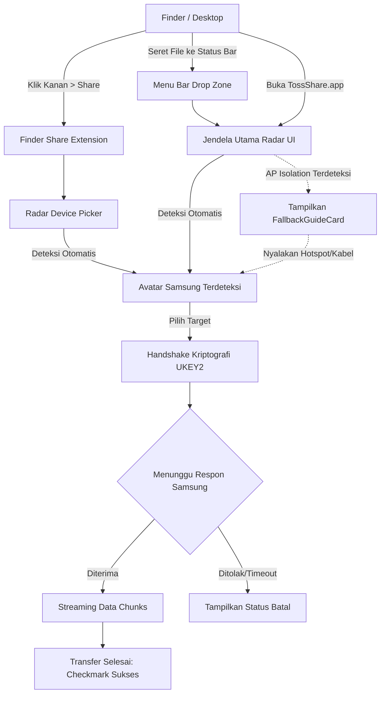
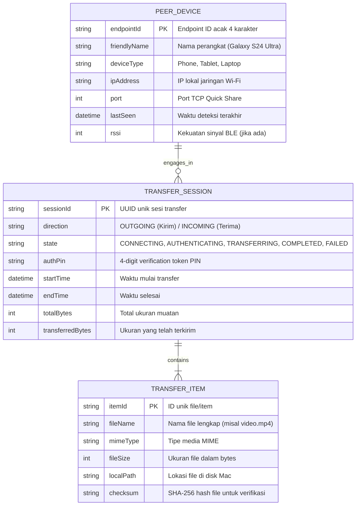

# Product Requirements Document (PRD): TossShare for macOS
## Aplikasi Transfer File Dua Arah Quick Share (Samsung & Android Compatible)

---

## 1. Ringkasan Eksekutif (Executive Summary)
**TossShare** adalah aplikasi macOS native berbasis Swift murni yang menghadirkan pengalaman transfer file dua arah (Kirim & Terima) antara seluruh lini komputer Mac (Apple Silicon & Intel) dan perangkat Samsung Galaxy (serta ekosistem Android) menggunakan protokol **Quick Share** bawaan sistem operasi.

Dibangun dengan merefaktor dan memperluas fondasi reverse-engineering dari [NearDrop](https://github.com/grishka/NearDrop) (yang sebelumnya hanya mendukung peran penerima *receive-only*), TossShare menghadirkan:
1. **Peran Pengirim (Sender Engine)** dengan penemuan otomatis perangkat Samsung tanpa memerlukan QR Code.
2. **Tanpa Aplikasi Tambahan di Samsung**: Pengguna Samsung cukup menggunakan fitur Quick Share bawaan One UI.
3. **Strategi Jaringan Bertingkat & Tangguh**: Mendukung Wi-Fi LAN lokal biasa, fallback nirkabel via **Mobile Hotspot** saat terjadi AP Isolation / ketiadaan router, serta fallback fisik ultra-cepat via **kabel USB-C Tethering**.
4. **Antarmuka AirDrop-Like**: Jendela Radar animasi konsentris SwiftUI, Menu Bar Drop Zone, dan integrasi Finder Share Extension (klik kanan > Share > TossShare).
5. **Universal & Aman**: Berjalan di macOS 13.0 (Ventura) ke atas tanpa hak akses `root`, tanpa menonaktifkan System Integrity Protection (SIP), dan tanpa memodifikasi kernel Bluetooth.

---

## 2. Pernyataan Masalah (Problem Statement)
Pengguna yang mengoperasikan ekosistem campuran—laptop macOS dan ponsel Samsung Galaxy—mengalami friksi produktivitas harian yang signifikan:
- **Eksklusivitas AirDrop**: AirDrop hanya berfungsi antar perangkat Apple.
- **Keterbatasan NearDrop**: Aplikasi komunitas NearDrop hanya mampu menerima file dari Android ke Mac, sedangkan pengiriman dari Mac ke Android mewajibkan pemindaian QR Code yang lambat dan canggung.
- **Overhead Aplikasi Pihak Ketiga**: Solusi alternatif seperti LocalSend atau KDE Connect mengharuskan instalasi aplikasi di kedua perangkat, menghilangkan kepraktisan berbagi instan bawaan sistem operasi.
- **Kendala Jaringan Lapangan**: Saat berada di luar ruangan tanpa router Wi-Fi atau di jaringan publik dengan *Client/AP Isolation* (hotel, kafe, kantor), transfer file nirkabel sering kali gagal tanpa kejelasan penyebab bagi pengguna.

---

## 3. Visi & Tujuan Produk (Product Vision & Goals)
- **Visi**: Menghadirkan pengalaman transfer file nirkabel sekelas AirDrop bagi pengguna Mac dan Samsung tanpa friksi konfigurasi.
- **Tujuan Utama**:
  - **Zero-Config Discovery**: Mac dapat menemukan ponsel Samsung yang siap menerima secara instan dalam < 2 detik.
  - **Full High-Speed Wi-Fi**: Memaksimalkan throughput jaringan lokal dengan enkripsi end-to-end berstandar industri (UKEY2).
  - **100% Native & Kompatibel**: Memastikan aplikasi dapat berjalan mulus di semua Mac (M1/M2/M3/M4 dan Intel) tanpa melanggar batasan keamanan macOS.

---

## 4. Target Pengguna & Persona (Target Users & Stakeholders)
- **Persona Utama**: Profesional kreatif, developer, mahasiswa, dan eksekutif yang menggunakan Mac (MacBook Air/Pro, Mac mini, iMac, Mac Studio) sebagai perangkat kerja utama dan Samsung Galaxy (Galaxy S Series, Z Fold/Flip, A Series, Galaxy Tab) sebagai perangkat seluler utama.
- **Kebutuhan Pengguna**: Memindahkan foto, video rekaman 4K, dokumen PDF, teks, dan tautan antar perangkat secara instan dalam hitungan detik.

---

## 5. Temuan Riset & Asumsi Kritis (Research & Critical Assumptions)
1. **Keterbatasan Core Bluetooth macOS**:
   - `CBPeripheralManager.startAdvertising(_:)` pada macOS secara keras menolak kunci `CBAdvertisementDataServiceDataKey`. Injeksi paket Service Data Fast Pair kustom (`0xFE2C`) ke kernel controller diblokir oleh SIP.
   - **Solusi Tervalidasi**: Menggunakan mode resmi Samsung Quick Share *"Everyone for 10 minutes"*, di mana Samsung secara otomatis mempublikasikan layanan mDNS `_FC9F5ED42C8A._tcp.` di jaringan lokal. Mac dapat membaca data ini menggunakan `NWBrowser` dan memindai sinyal kedekatan BLE menggunakan `CBCentralManager`.
2. **Ketiadaan Wi-Fi Direct pada macOS**:
   - macOS hanya mendukung AWDL (milik Apple) dan mode infrastruktur Wi-Fi biasa.
   - **Solusi Tervalidasi**: Komunikasi menggunakan Wi-Fi LAN bersama. Saat jaringan terisolasi atau di luar ruangan, aplikasi memicu fallback otomatis ke **Mobile Hotspot Samsung** atau **USB-C Tethering**.
3. **Asumsi Protokol Quick Share**:
   - Perangkat target Samsung menjalankan Android 10+ dengan Google Play Services / Quick Share One UI terpadu.

---

## 6. Ruang Lingkup Produk (Scope: MoSCoW, Rabbit Holes & No-Gos)

### MoSCoW Scoping
- **Must-Have (M)**:
  - Penemuan otomatis perangkat Samsung via mDNS (`_FC9F5ED42C8A._tcp.`) dan BLE Central scanning (`CBCentralManager`).
  - Pengiriman file dari Mac ke Samsung (UKEY2 Client Role, framing metadata, chunked streaming).
  - Penerimaan file dari Samsung ke Mac (UKEY2 Server Role, refaktor NearDrop ke Swift Concurrency).
  - Jendela Radar SwiftUI dengan visualisasi perangkat terdekat dan target drag-and-drop.
  - Menu Bar status item dengan Drop Zone.
  - Finder Share Extension (`com.apple.share-services`) untuk klik kanan di Finder.
  - Mesin diagnosa jaringan (*Network Health Monitor*) dengan panduan otomatis AP Isolation.
  - Dukungan fallback Mobile Hotspot dan USB-C Tethering.
- **Should-Have (S)**:
  - Pengiriman multi-file sekaligus dan teks/URL mentah dari clipboard.
  - Estimasi waktu transfer tersisa (*Time Remaining*) dan progress bar dinamis.
  - Penamaan otomatis file duplikat (misal: `foto (1).jpg`) tanpa menimpa berkas lama.
- **Could-Have (C)**:
  - Mode Fallback QR Code jika mDNS terblokir dan pengguna menolak menggunakan Hotspot.
- **Won't-Have (W) / No-Gos**:
  - 🚫 **No-Go**: Penulisan kernel extension (`.kext`) atau modifikasi private Bluetooth HCI yang mewajibkan penonaktifan SIP.
  - 🚫 **No-Go**: Mengharuskan instalasi aplikasi pendamping (companion APK) pada perangkat Samsung.
  - 🚫 **No-Go**: Membutuhkan akun cloud atau koneksi server eksternal di internet.

---

## 7. Alur Pengguna Inti (Core User Journeys)

### Alur 1: Mengirim Berkas dari Mac ke Samsung (Sender Journey)
```
[Pengguna Samsung]
1. Buka Quick Settings -> Tekan tombol "Quick Share" -> Atur ke "Everyone for 10 minutes"
       │
       ▼
[Pengguna Mac]
2. Klik kanan file di Finder > Share > TossShare (atau seret file ke Jendela Radar TossShare)
3. Radar menampilkan ikon dan nama perangkat Samsung (misal: "Galaxy S24 Ultra")
4. Klik avatar "Galaxy S24 Ultra"
       │
       ▼
[Ponsel Samsung]
5. Muncul prompt dialog bawaan: "MacBook Pro ingin membagikan 3 file [Tolak] [Terima]"
6. Pengguna Samsung menekan "Terima"
       │
       ▼
[Transfer Berjalan]
7. Data streaming berkecepatan tinggi via Wi-Fi lokal dengan indikator progress
8. Selesai: Checkmark sukses di Mac, file tersimpan di galeri/folder Downloads Samsung
```

### Alur 2: Menerima Berkas dari Samsung ke Mac (Receiver Journey)
1. Aplikasi TossShare aktif di background / Menu Bar Mac.
2. Pengguna Samsung memilih berkas di ponsel > tekan tombol **Share** > pilih **Quick Share**.
3. Nama Mac pengguna (misal: *"MacBook Pro M1"*) langsung muncul di daftar Quick Share Samsung.
4. Pengguna Samsung memilih Mac tersebut.
5. Mac menampilkan notifikasi sistem native: *"Galaxy S24 Ultra ingin mengirim 1 file. [Decline] [Accept]"*.
6. Pengguna Mac menekan **"Accept"**; berkas tersimpan otomatis di `~/Downloads`.

### Alur 3: Penanganan Fallback Saat AP Isolation / Tanpa Router
1. Pengguna mencoba mengirim file di kafe dengan Wi-Fi publik.
2. Mesin diagnosa TossShare mendeteksi sambungan TCP ke Samsung diblokir oleh router (AP Isolation).
3. TossShare otomatis menampilkan kartu panduan fallback di Radar UI:
   - *"Wi-Fi publik memblokir koneksi lokal. Silakan aktifkan Mobile Hotspot di Samsung Anda, lalu hubungkan Mac Anda."*
4. Pengguna menyalakan Hotspot di Samsung -> Mac otomatis tersambung.
5. Radar TossShare otomatis mendeteksi koneksi baru -> status berubah menjadi hijau -> transfer berjalan lancar tanpa menggunakan kuota data seluler.

---

## 8. Diagram Alur Layar & UI Wireframe



### ASCII Wireframe: Jendela Radar SwiftUI
```
+-------------------------------------------------------------+
|  [●][●][●]                  TossShare                  [⚙]  |
+-------------------------------------------------------------+
|                                                             |
|                         ( ( (   ) ) )                       |
|                                                             |
|                    +---------------------+                  |
|                    |     📱 Galaxy S24   |                  |
|                    |     192.168.1.105   |                  |
|                    |     [Siap Terima]   |                  |
|                    +---------------------+                  |
|                                                             |
|             +-------------+                                 |
|             |  📱 Tab S9  |                                 |
|             +-------------+                                 |
|                                                             |
|                                                             |
|    [  Tarik & Lepas File ke Avatar untuk Mengirim  ]        |
|                                                             |
+-------------------------------------------------------------+
|  Status: Memindai perangkat Wi-Fi lokal...                  |
|  💡 Pastikan Quick Share Samsung aktif (Everyone 10 min)   |
+-------------------------------------------------------------+
```

---

## 9. Konseptual Skema Data (Mermaid ERD)



---

## 10. Persyaratan Fungsional (Functional Requirements)
- **FR-001 (mDNS Browser)**: Aplikasi wajib memindai layanan mDNS `_FC9F5ED42C8A._tcp.` pada seluruh antarmuka jaringan lokal aktif menggunakan `NWBrowser`.
- **FR-002 (Endpoint Decoding)**: Aplikasi wajib mengurai TXT record `n` untuk mengekstrak identitas perangkat, nama pengguna (*friendly name*), dan tipe perangkat target (Phone/Tablet).
- **FR-003 (UKEY2 Client Role)**: Aplikasi wajib mengimplementasikan jabat tangan UKEY2 peran Klien: membangkitkan `ClientInit`, memproses `ServerInit`, menurunkan kunci otentikasi bersama via HKDF-SHA256, menghitung 4-digit verification token PIN, dan mengirim `ClientFinish`.
- **FR-004 (Framing Metadata)**: Aplikasi wajib mengonstruksi protobuf `ConnectionRequestFrame` dan `IntroductionFrame` yang membawa informasi detail berkas (nama, ukuran, MIME type).
- **FR-005 (Acceptance Handling)**: Aplikasi wajib memvalidasi respon penerimaan (`AcceptanceFrame`) dari perangkat Samsung sebelum memulai transfer muatan biner.
- **FR-006 (Chunked Streaming)**: Aplikasi wajib mengalirkan berkas secara *chunked streaming* (buffer 512KB per blok) yang dienkripsi dengan frame UKEY2 untuk membatasi konsumsi memori RAM sistem (< 50 MB).
- **FR-007 (Finder Share Extension)**: Aplikasi wajib menyertakan target ekstensi Finder Share (`com.apple.share-services`) yang terintegrasi langsung dengan menu klik kanan macOS.
- **FR-008 (Receiver Server Engine)**: Aplikasi wajib menyediakan server penerima berbasis `NWListener` (adaptasi NearDrop dengan Swift Concurrency) untuk menerima kiriman dari Samsung.
- **FR-009 (Network Health Monitor)**: Aplikasi wajib memantau status jaringan dan mendeteksi kondisi AP Isolation atau pemblokiran soket lokal secara otomatis.
- **FR-010 (Fallback Advisor)**: Aplikasi wajib menyajikan instruksi peralihan otomatis ke Mobile Hotspot atau USB-C Tethering saat kondisi jaringan terisolasi.

---

## 11. Persyaratan Non-Fungsional (Non-Functional Requirements)
- **NFR-001 (Performa Throughput)**: Kecepatan transfer pada jaringan Wi-Fi 5GHz/6GHz harus mampu mencapai minimal 25 MB/s, dan pada kabel USB-C mencapai minimal 250 MB/s.
- **NFR-002 (Kompatibilitas Sistem)**: Mendukung macOS 13.0 (Ventura), 14.0 (Sonoma), dan 15.0+ (Sequoia) sebagai Universal Binary (arm64 Apple Silicon & x86_64 Intel).
- **NFR-003 (Keamanan & Privasi)**: Seluruh komunikasi data wajib dienkripsi end-to-end (ECDH Curve P-256 + AES-GCM 128/256-bit). Data berpindah secara langsung *peer-to-peer* lokal tanpa melibatkan server pihak ketiga mana pun (mematuhi UU PDP).
- **NFR-004 (Integritas macOS)**: Aplikasi tidak boleh memerlukan hak administrator (`root`), instalasi kext, atau penonaktifan System Integrity Protection (SIP).
- **NFR-005 (Efisiensi Sumber Daya)**: Penggunaan CPU saat idle harus < 0.5% dan penggunaan RAM < 60 MB.

---

## 12. Aturan Bisnis (Business Rules)
- **BR-001 (Resolusi Duplikasi File)**: Jika file yang diterima memiliki nama yang identik dengan file di folder tujuan, sistem menambahkan nomor urut otomatis (misal: `laporan (1).pdf`) tanpa menimpa file yang sudah ada.
- **BR-002 (Pembersihan File Batal)**: Jika transfer dibatalkan atau terputus di tengah jalan, seluruh file temporer yang belum tuntas wajib dihapus dari disk secara bersih.
- **BR-003 (Opsi Folder Tujuan)**: Folder penyimpanan default adalah `~/Downloads`, namun pengguna dapat mengubah folder tujuan melalui menu Pengaturan.

---

## 13. Persyaratan UX & Aksesibilitas
- Animasi radar konsentris SwiftUI yang responsif dengan haptic feedback pada trackpad Mac.
- Tampilan status real-time: indikator kecepatan transfer (MB/s), persentase progress bar, dan estimasi waktu tersisa (*time remaining*).
- Dukungan otomatis mode tampilan Dark Mode dan Light Mode sesuai preferensi macOS.

---

## 14. Edge Cases, Penanganan Error & Strategi Fallback Bertingkat
1. **AP / Client Isolation**:
   - Jika mDNS terdeteksi namun koneksi TCP gagal dibuka, sistem menampilkan kartu `FallbackGuideCard`: menyarankan menyalakan Mobile Hotspot di Samsung.
2. **Ketiadaan Router (Luar Ruangan)**:
   - Pengguna menyalakan Mobile Hotspot di Samsung -> Mac terhubung -> terbentuk subnet lokal pribadi (`192.168.43.x`) -> transfer berjalan normal tanpa menggunakan kuota data seluler.
3. **Transfer Berkas Raksasa (> 20 GB)**:
   - Pengguna dapat menghubungkan kabel USB-C dan mengaktifkan USB Tethering di Samsung untuk kecepatan transfer kabel USB 3.0 (300–800 MB/s).
4. **Timeout Persetujuan**:
   - Jika pengguna Samsung tidak menekan tombol "Terima" dalam 60 detik, Mac membatalkan sesi transfer secara anggun (*graceful timeout*).

---

## 15. Metrik Keberhasilan (Success Metrics / KPIs)
- **Tingkat Keberhasilan Penemuan**: > 95% perangkat Samsung dalam mode "Everyone 10 min" terdeteksi dalam waktu < 2 detik di jaringan lokal.
- **Tingkat Keberhasilan Transfer**: > 98% transfer file berhasil tanpa korupsi data (diverifikasi dengan checksum SHA-256).
- **Waktu Inisiasi**: Pengguna dapat memicu pengiriman file dari Finder dalam waktu < 5 detik.

---

## 16. Risiko, Mitigasi & Hasil Pre-Mortem
- **Risiko 1 (Batas Waktu 10 Menit Quick Share)**:
  - *Akar Masalah*: Pengguna lupa bahwa toggle "Everyone" di Samsung otomatis nonaktif setelah 10 menit.
  - *Mitigasi*: Menampilkan teks bantuan persisten di antarmuka radar: *"Pastikan Quick Share di Samsung aktif ke 'Everyone for 10 min'"*.
- **Risiko 2 (Pembaruan Protokol Google/Samsung)**:
  - *Akar Masalah*: Perubahan skema protobuf atau parameter cipher TLS pada pembaruan Android mendatang.
  - *Mitigasi*: Arsitektur framing protokol diisolasi secara modular (`DropCore/Protocol`) sehingga mudah diperbarui tanpa mengganggu logika antarmuka dan jaringan.

---

## 17. Kriteria Penerimaan (Acceptance Criteria)

#### Skenario 1: Penemuan Otomatis Samsung
- **Given**: Pengguna membuka Radar TossShare di Mac dan perangkat Samsung mengaktifkan Quick Share "Everyone for 10 minutes" pada Wi-Fi yang sama.
- **When**: Mac memindai jaringan lokal.
- **Then**: Avatar dan nama perangkat Samsung muncul di Radar Mac dalam waktu < 2 detik tanpa QR Code.

#### Skenario 2: Mengirim Berkas Sukses
- **Given**: Berkas video sebesar 2 GB dipilih di Mac dan perangkat Samsung telah terdeteksi.
- **When**: Pengguna mengklik target Samsung dan menekan "Terima" pada layar ponsel Samsung.
- **Then**: Berkas ditransfer dengan kecepatan penuh Wi-Fi, tersimpan utuh di folder penyimpanan Samsung, dan status Mac menampilkan centang sukses.

#### Skenario 3: Penanganan Fallback AP Isolation
- **Given**: Mac dan Samsung terhubung ke Wi-Fi publik yang mengaktifkan AP Isolation.
- **When**: Pengguna mencoba mengirim berkas.
- **Then**: TossShare mendeteksi kegagalan soket dan menampilkan panduan beralih ke Mobile Hotspot dalam 2 langkah mudah.

---

## 18. Pertanyaan Terbuka & Next Steps
- Seluruh keputusan arsitektur kunci telah disepakati dan divalidasi.
- Langkah selanjutnya adalah eksekusi implementasi kode berdasarkan dokumen handoff teknis di `docs/coding-handoff.md`.
