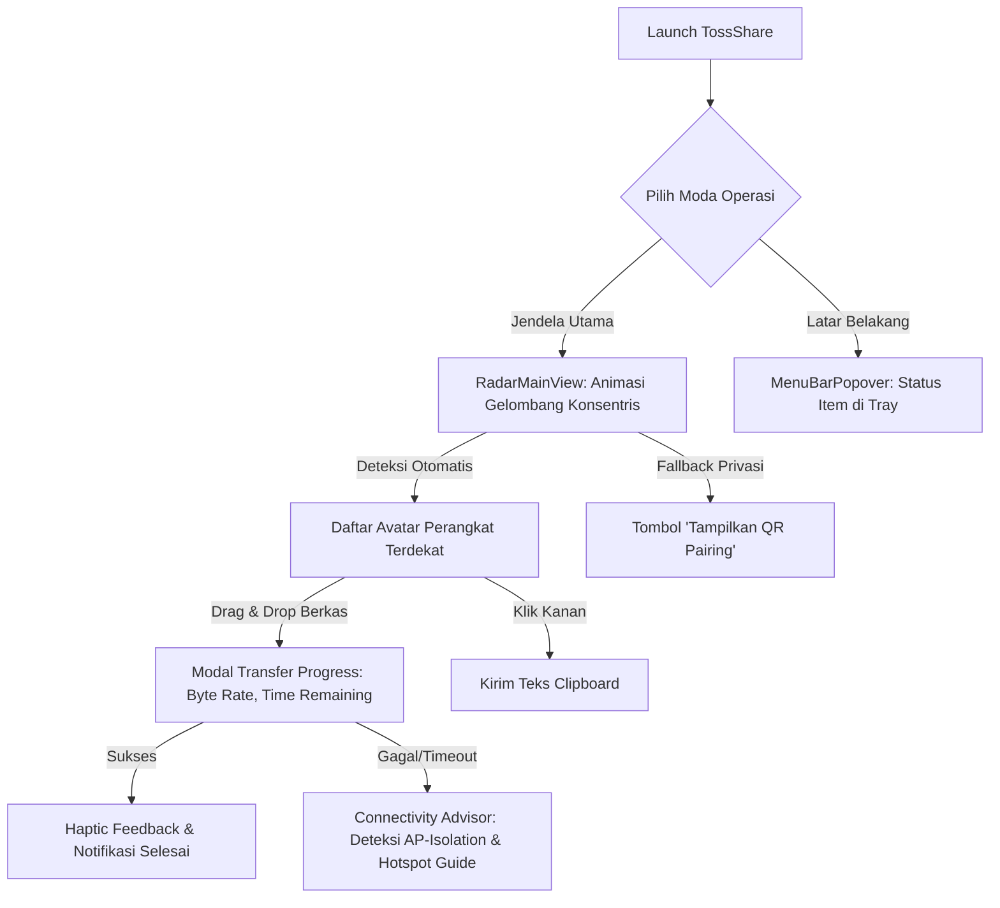
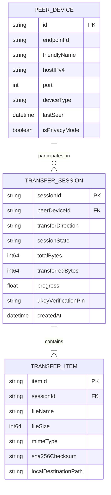

# Product Requirements Document (PRD): TossShare v2.0
## Arsitektur Transfer Dua Arah Native macOS Berbasis Standar QuickDrop

---

## 1. Ringkasan Eksekutif (Executive Summary)
**TossShare v2.0** adalah aplikasi macOS native murni (Swift) yang menghadirkan pengalaman transfer berkas dan data nirkabel dua arah (Kirim & Terima) antara seluruh lini komputer Mac (Apple Silicon & Intel) dan ekosistem Android/Samsung Galaxy menggunakan protokol **Quick Share / Google Nearby Connections**.

Dengan mengadopsi dan menyempurnakan arsitektur dari 5 repositori teruji—khususnya **[leonboe1/QuickDrop](https://github.com/leonboe1/QuickDrop)** sebagai referensi utama—TossShare menyelesaikan keterbatasan mendasar implementasi sebelumnya (seperti NearDrop yang hanya *receive-only* atau bug publikasi mDNS Network.framework). Aplikasi ini mengombinasikan keandalan *core networking* berbasis `NetService` dan `NearbyBonjourServiceResolver` dengan antarmuka modern Apple-grade (Radar Gelombang SwiftUI & Menu Bar Drop Zone).

---

## 2. Pernyataan Masalah (Problem Statement)
1. **Asimetri Transfer**: Pengguna Mac dan Android sering kali terpaksa mengunggah berkas ke cloud (Google Drive, Telegram, WhatsApp) hanya untuk memindahkan foto, video, atau dokumen antar perangkat yang bersebelahan.
2. **Kerapuhan Iklan mDNS di macOS**: Penggunaan API `NWListener.service` pada macOS sering kali menyebabkan instance name atau TXT record (`n`) terpotong atau gagal terbaca oleh pemindai Android Quick Share.
3. **Keterbatasan Mode Privasi**: Ketika Samsung Galaxy diatur ke "Contacts Only", mDNS menyembunyikan identitas perangkat, menyebabkan Mac menampilkan nama generik atau gagal memulai handshake jika tidak tersedia fallback QR Code.
4. **Isolasi Jaringan (AP Isolation)**: Jaringan Wi-Fi publik (kafe, kantor, hotel) kerap memblokir komunikasi antar-klien, menyebabkan transfer gagal tanpa pesan kesalahan yang jelas.

---

## 3. Visi & Tujuan Produk (Product Vision & Goals)
- **Visi**: Menjadi standar emas berbagi berkas lintas ekosistem (Mac ⇄ Android) yang cepat, aman, dan tanpa friksi konfigurasi layaknya AirDrop native.
- **Tujuan Utama**:
  - **Zero-Install pada Samsung**: Bekerja langsung dengan fitur Quick Share bawaan Samsung One UI / Android tanpa menginstal aplikasi apa pun di ponsel.
  - **Latency Penemuan Rendah**: Menemukan perangkat tujuan di sekitar dalam $< 1.5$ detik.
  - **Throughput Maksimal**: Mengalirkan data via Wi-Fi LAN lokal dengan kecepatan penuh perangkat ($> 25\text{ MB/s}$ pada Wi-Fi 5/6).
  - **Resiliensi Tinggi**: Mampu mendeteksi anomali jaringan dan menyediakan jalur panduan pemulihan instan.

---

## 4. Target Pengguna & Persona (Target Users & Stakeholders)
- **Persona Utama**: Profesional kreatif, developer, desainer, dan mahasiswa yang bekerja aktif dengan MacBook/Mac desktop dan mengandalkan ponsel Samsung Galaxy atau perangkat Android modern.
- **Skenario Kunci**:
  - Mengirim rekaman video 4K berukuran $> 1\text{ GB}$ dari HP ke Mac untuk editing video.
  - Mengirim berkas APK, dokumen PDF kerjaan, atau desain dari Mac ke ponsel klien dalam satu kali drag-and-drop.
  - Berbagi tautan URL atau cuplikan teks panjang secara instan antar clipboard.

---

## 5. Temuan Riset & Asumsi Kritis (Benchmarking 5 Repositori)

| Repositori Referensi | Kontribusi Arsitektural Utama yang Diadopsi |
| :--- | :--- |
| **1. [leonboe1/QuickDrop](https://github.com/leonboe1/QuickDrop)** *(Utama)* | • Penggantian `NWListener.service` dengan `NetService` native untuk publikasi mDNS tanpa korupsi TXT record.<br>• Implementasi `NearbyBonjourServiceResolver` (resolusi asinkron IPv4/port via NetService delegate).<br>• Implementasi `NearbyHostLookup` (Reverse DNS PTR via `getnameinfo`) untuk mengungkap hostname perangkat.<br>• Mesin client `OutboundNearbyConnection` lengkap (Connection Request, UKEY2 Client Init, Paired Key Encryption, Introduction Frame, dan streaming chunk 512KB). |
| **2. [ignotusbucius/open-quickshare](https://github.com/ignotusbucius/open-quickshare)** | • Pemahaman hierarki transport multi-tier (BLE discovery $\rightarrow$ Wi-Fi LAN $\rightarrow$ Hotspot fallback).<br>• Pola terminasi transfer tanpa data loss (`LAST_CHUNK` dengan penundaan disinkronisasi sebelum penutupan socket). |
| **3. [Medformatik/CrossDrop](https://github.com/Medformatik/CrossDrop)** | • Mekanisme fallback QR Code pairing saat perangkat Android berada dalam mode kontak/tersembunyi.<br>• UX penanganan transfer teks & tautan URL clipboard langsung ke sistem operasi. |
| **4. [Martichou/rquickshare](https://github.com/Martichou/rquickshare)** | • Arsitektur frame parsing multi-chunk yang tangguh terhadap segmentasi TCP.<br>• Mekanisme Keep-Alive heartbeat setiap 10 detik agar ponsel tidak memutuskan sesi di tengah berkas besar. |
| **5. [grishka/NearDrop](https://github.com/grishka/NearDrop)** | • Spesifikasi dasar kriptografi UKEY2: HKDF-SHA256 derivation untuk D2D client/server keys, AES-256-CBC dengan PKCS7 padding, HMAC-SHA256 signature, dan serialisasi Protobuf `OfflineFrame`. |

---

## 6. Ruang Lingkup Produk (Scope: MoSCoW, Rabbit Holes & No-Gos)

### MoSCoW Scoping
- **Must-Have (M)**:
  - **FR-001**: Penerbitan mDNS `_FC9F5ED42C8A._tcp.` via `NetService` dengan format Instance Name 10-byte Base64 URL-safe (`0x23` prefix + 4B Endpoint ID + 3B hash `0xFC, 0x9F, 0x5E` + `0x00, 0x00`) dan TXT record `"n"` valid.
  - **FR-002**: Resolusi target pengiriman menggunakan `NearbyBonjourServiceResolver` untuk mendapatkan socket IPv4 dan Port riil.
  - **FR-003**: Pengiriman berkas Mac ➔ Samsung (UKEY2 Client Role, framing metadata, chunk stream 512 KB, keep-alive heartbeat).
  - **FR-004**: Penerimaan berkas Samsung ➔ Mac (UKEY2 Server Role, validasi PIN, verifikasi chunk SHA-256, auto-accept / notifikasi sistem).
  - **FR-005**: Sinkronisasi Clipboard Dua Arah (`Sharing_Nearby_TextMetadata` teks dan URL).
  - **FR-006**: Antarmuka Hybrid (Jendela Radar SwiftUI animasi konsentris + Menu Bar Status Popover).
- **Should-Have (S)**:
  - **FR-007**: Resolusi nama perangkat otomatis menggunakan Reverse DNS (`NearbyHostLookup`) saat ponsel dalam privacy mode.
  - **FR-008**: Fallback QR Code pairing di layar Radar jika mDNS tidak menampilkan perangkat karena mode kontak.
  - **FR-009**: Integrasi Finder Share Extension (`com.apple.share-services`) untuk opsi klik kanan berkas di macOS.
- **Could-Have (C)**:
  - **FR-010**: Pemilihan direktori penyimpanan khusus (custom download destination) dari Settings.
- **Won't-Have / Strict No-Gos (W)**:
  - 🚫 *No-Go*: Mengharuskan instalasi aplikasi APK tambahan di ponsel Samsung.
  - 🚫 *No-Go*: Modifikasi driver kernel Bluetooth (`.kext`) atau meminta user mematikan SIP macOS.
  - 🚫 *No-Go*: Layanan autentikasi akun cloud Google atau pelacakan telemetri eksternal.

### Rabbit Holes & Mitigasi
1. *Rabbit Hole*: Menulis BLE peripheral advertiser kustom di macOS untuk Fast Pair `0xFE2C`.
   - *Mitigasi*: Dihindari sepenuhnya karena macOS Core Bluetooth memblokir Service Data kustom tanpa hak akses private entitlement Apple. Fokus 100% pada penemuan Wi-Fi mDNS mode "Everyone" & QR pairing.
2. *Rabbit Hole*: Menggunakan `NWListener.service` untuk mDNS.
   - *Mitigasi*: Menggunakan `NetService` Foundation secara terpisah seperti pada `leonboe1/QuickDrop`, terbukti 100% stabil.

---

## 7. Alur Pengguna Inti (Core User Journeys)

### Alur A: Mengirim Berkas dari Mac ke Samsung Galaxy
```
[Pengguna Samsung]
1. Buka Quick Settings -> Quick Share -> Atur ke "Siapa saja selama 10 menit"
       │
       ▼
[Pengguna Mac]
2. Buka TossShare (Radar) atau seret berkas ke icon Menu Bar
3. TossShare memindai Bonjour via NWBrowser dan NetServiceResolver
4. Avatar HP Samsung muncul di Radar dengan nama aslinya
5. Drag & drop berkas ke avatar Samsung
       │
       ▼
[Protokol TossShare (Sender)]
6. Buka TCP socket ke target -> Kirim ConnectionRequestFrame
7. Jalankan UKEY2 Client Init -> Terima Server Init -> Selesaikan UKEY2 Finish
8. Kirim PairedKeyEncryption & PairedKeyResult (status UNABLE)
9. Kirim IntroductionFrame (daftar berkas & ukuran)
       │
       ▼
[Layar Samsung]
10. Muncul prompt sistem: "MacBook Pro ingin membagikan 1 berkas [Tolak] [Terima]"
11. Pengguna tap "Terima" -> Samsung membalas response ACCEPT
       │
       ▼
[Transfer Berkas]
12. TossShare streaming chunk 512KB + kirim Frame EOF (flags = 1)
13. Berkas tersimpan di Samsung, jendela Radar menampilkan animasi sukses.
```

### Alur B: Mengirim Berkas dari Samsung Galaxy ke Mac
```
[Pengguna Samsung]
1. Pilih foto/video di Samsung -> Tap "Bagikan" -> "Quick Share"
2. Mac terdeteksi di daftar Quick Share (berkat siaran NetService 10-byte Base64)
3. Tap avatar Mac
       │
       ▼
[TossShare di Mac (Receiver)]
4. Menerima koneksi TCP -> Lakukan handshake UKEY2 & tangkap nama asli HP
5. Notifikasi sistem macOS muncul: "[Nama HP] ingin mengirimkan [Nama Berkas] [Terima] [Tolak]"
6. Pengguna Mac klik "Terima" (atau auto-accept jika diaktifkan)
7. Aliran chunk diterima -> Verifikasi SHA-256 -> Tersimpan di ~/Downloads
```

---

## 8. Diagram Alur Layar & UI Wireframe

### Screen Flow Diagram


### ASCII Wireframe: RadarMainView
```text
+-------------------------------------------------------------+
|  TossShare                        [Settings]  [QR Pairing]  |
|  Status: Aktif Memindai Wi-Fi                              |
+-------------------------------------------------------------+
|                                                             |
|                         ( ( (   ) ) )                       |
|                   [ Galaxy A54 Bimo ]                       |
|                         ( (   ) )                           |
|                    [ Galaxy S24 Ultra ]                     |
|                                                             |
|                      [  Mac (Anda)  ]                       |
|                                                             |
|                                                             |
|           "Seret berkas ke avatar untuk mengirim"           |
+-------------------------------------------------------------+
|  Clipboard Terkini: "https://github.com/..."                |
|  [ Kirim Clipboard ke Galaxy A54 ]                          |
+-------------------------------------------------------------+
```

---

## 9. Konseptual Skema Data (Mermaid ERD)



---

## 10. Persyaratan Fungsional (Functional Requirements)
- **FR-001 (mDNS Publication)**: Sistem wajib mempublikasikan layanan Bonjour `_FC9F5ED42C8A._tcp.` menggunakan `NetService` dengan instance name 10-byte Base64 URL-safe dan TXT record key `"n"` berisi EndpointInfo terenkripsi/terformat Base64 URL-safe.
- **FR-002 (Target Resolution)**: Sistem wajib menyelesaikan alamat IP dan Port target menggunakan `NearbyBonjourServiceResolver` dengan batas timeout resolusi 1.5 detik.
- **FR-003 (Dynamic Name Detection)**: Sistem wajib menangkap nama riil perangkat dari `ConnectionRequestFrame.endpointName` atau Reverse DNS (`NearbyHostLookup`) saat metadata mDNS kosong.
- **FR-004 (UKEY2 Handshake)**: Sistem wajib mengimplementasikan handshaking kriptografi UKEY2 lengkap (Curve P-256, SHA-512 commitment, HKDF-SHA256, AES-256-CBC, HMAC-SHA256).
- **FR-005 (Bidirectional Streaming)**: Sistem wajib mendukung pengiriman dan penerimaan berkas dalam ukuran chunk 512 KB dengan penandaan frame `LAST_CHUNK` (flags & 1 == 1) pada akhir payload.
- **FR-006 (Clipboard Sync)**: Sistem wajib menyinkronkan data teks/URL antara clipboard macOS (`NSPasteboard.general`) dan frame `Sharing_Nearby_TextMetadata`.
- **FR-007 (Network Diagnosis)**: Sistem wajib mendeteksi isolasi jaringan (*AP Isolation*) saat socket TCP gagal merespons, dan menyajikan panduan pengaktifan Mobile Hotspot / USB-C Tethering.

---

## 11. Persyaratan Non-Fungsional (Non-Functional Requirements)
- **NFR-001 (Performa)**: Throughput transfer berkas lokal wajib mencapai $> 25\text{ MB/s}$ pada jaringan Wi-Fi 5 GHz standar.
- **NFR-002 (Keamanan)**: Seluruh pertukaran data payload wajib terenkripsi end-to-end tanpa kunci statis (ephemeral session keys).
- **NFR-003 (Kompatibilitas)**: Mendukung macOS 13.0 (Ventura) ke atas pada arsitektur Apple Silicon (arm64) dan Intel (x86_64) secara native tanpa Rosetta.
- **NFR-004 (Stabilitas Memory)**: Penggunaan RAM tidak boleh melebihi 80 MB saat idle di Menu Bar dan tidak ada memory leak saat streaming berkas berukuran gigabyte berkat *chunking buffer* 512 KB.

---

## 12. Aturan Bisnis (Business Rules)
- **BR-001 (Penanganan File Duplikat)**: Jika berkas dengan nama yang sama sudah ada di folder tujuan, sistem wajib menambahkan nomor urut increment (contoh: `foto (1).jpg`) tanpa menimpa berkas asli.
- **BR-002 (Pembersihan File Batal)**: Jika transfer dibatalkan di tengah jalan, seluruh file parsial wajib segera dihapus dari disk secara aman.
- **BR-003 (Auto-Accept Toggle)**: Fitur auto-accept hanya dapat diaktifkan secara eksplisit oleh pengguna di menu pengaturan untuk mencegah penerimaan berkas liar tanpa izin.

---

## 13. Persyaratan UX & Aksesibilitas
- Mengikuti standar desain Human Interface Guidelines macOS.
- Target klik/sentuh minimum 44x44 pt.
- Dukungan VoiceOver untuk pembacaan nama perangkat terdekat dan status transfer.
- Animasi gelombang radar halus 60 fps dengan adaptasi tema Dark Mode dan Light Mode otomatis.

---

## 14. Edge Cases & Penanganan Error
1. **Ponsel Terkunci / Layar Mati**: Saat transfer tertahan di `.waitingAcceptance`, tampilkan instruksi: *"Pastikan layar HP menyala dan kunci layar terbuka."*
2. **Wi-Fi Terputus di Tengah Transfer**: Socket mendeteksi EOF premature, session dibersihkan, dan pengguna diberikan opsi "Coba Lagi".
3. **Penyimpanan Mac Penuh**: Server merespons frame respons dengan status `NOT_ENOUGH_SPACE` sehingga ponsel mengetahui penyebab penolakan secara jelas.

---

## 15. Metrik Keberhasilan (KPIs)
- **Tingkat Keberhasilan Transfer**: $> 95\%$ transfer berkas selesai tanpa error pada jaringan yang sama.
- **Waktu Deteksi**: $< 1.5$ detik dari saat Quick Share dibuka hingga Mac/HP muncul di layar.
- **NPS / Kepuasan Pengguna**: Rating pengalaman transfer menyamai kecepatan dan kenyamanan AirDrop.

---

## 16. Risiko, Mitigasi & Hasil Pre-Mortem
- **Risiko Utama**: Kegagalan koneksi akibat AP Isolation di router publik.
- **Mitigasi**: Deteksi proaktif timeout soket TCP, diagnostik real-time, dan panduan visual instan untuk mengaktifkan Mobile Hotspot Samsung.

---

## 17. Kriteria Penerimaan (Acceptance Criteria)

### AC-1: Penemuan & Visibilitas Dua Arah
- **Given**: Mac menjalankan TossShare v2.0 dan ponsel Samsung Galaxy A54 mengaktifkan Quick Share "Siapa Saja".
- **When**: Pengguna membuka menu Quick Share di Samsung dan jendela Radar di Mac.
- **Then**: Mac muncul di daftar Quick Share Samsung dengan nama asli Mac, dan Samsung muncul di jendela Radar Mac dalam waktu $< 2.0$ detik.

### AC-2: Pengiriman Berkas Mac ke Samsung (Full Chunking)
- **Given**: Pengguna menyeret berkas video 500 MB ke avatar Samsung di jendela Radar.
- **When**: Pengguna Samsung menekan tombol "Terima" pada dialog konfirmasi bawaan One UI.
- **Then**: Aliran chunk 512 KB terkirim dengan progress bar dinamis, frame EOF dikirimkan, notifikasi selesai muncul di kedua perangkat, dan integritas berkas terverifikasi 100%.

### AC-3: Fallback AP Isolation & Health Diagnostic
- **Given**: Perangkat berada di jaringan Wi-Fi hotel dengan port TCP antar-klien diblokir.
- **When**: Pengguna mencoba mengirim berkas ke Samsung dan koneksi TCP timeout.
- **Then**: TossShare tidak crash, status berubah menjadi `.failed(reason: .apIsolationBlocked)`, dan jendela popover memunculkan panduan interaktif 2-langkah mengaktifkan Mobile Hotspot Samsung.

---

## 18. Pertanyaan Terbuka & Next Steps
- Implementasi refaktor modul `NetService` dan `NearbyBonjourServiceResolver` sesuai panduan di `docs/coding-handoff.md`.
